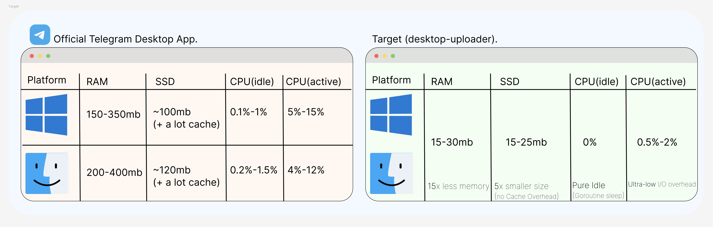
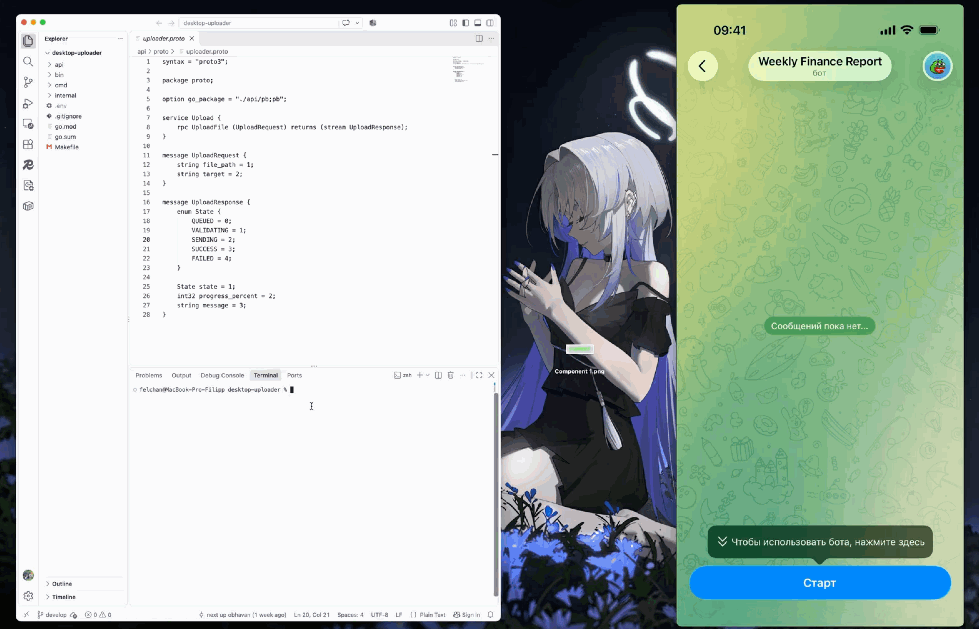
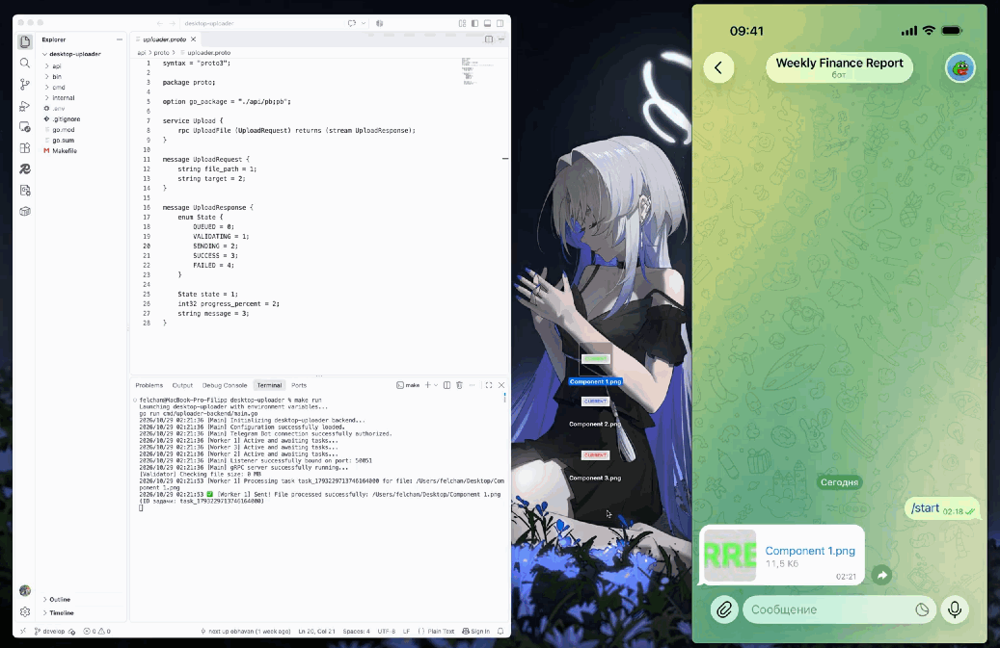

# Desktop Uploader 🚀📂

A highly performant, native desktop integration system designed to asynchronously intercept, validate, and stream file payloads directly into Telegram cloud channels. Built with Go using Clean Architecture principles, cross-platform gRPC protocols, and a concurrent buffer-allocated worker pool engine.

## 🛠 Technology Stack

*   **Backend Core:** Go (Golang) inside clean enterprise domain modules.
*   **Transport Layer:** gRPC via optimized Protocol Buffers (v3) schemas.
*   **Concurrency Engine:** Thread-safe buffered Go channels with bounded thread isolation primitives.
*   **Native Integration:** macOS Quick Actions / Services framework powered by structured shell arguments.

## 🏗 Architecture Design

The system routes Finder context menu actions through a lightweight client to a persistent gRPC backend and concurrent worker pool.

## ⚡ Key Architectural Patterns Implemented

1. **Zero-Idle Resource Footprint:** Transient client utility achieves a **0 MB RAM idle state** for the interface.
2. **Concurrent Buffer-Allocated Worker Pool:** Tasks are distributed asynchronously across channels using detached goroutines.
3. **Rigorous Native Edge Validation:** Defensive OS modules prevent invalid sector reads.
4. **Isomorphic Graceful Interruption Lifecycle:** Wired with POSIX termination signals (`SIGINT`, `SIGTERM`) for safe shutdowns.

## 📊 Performance Benchmarks

Below is a detailed layout of resource footprints comparing our native architecture against the official heavyweight client wrapper:



## 🎬 End-to-End System Demonstration

*   **Single File Dispatch:** 
    
*   **Parallel Batch Upload (3 Workers running concurrently):** 
    

## 🗺 Engineering & Development Process

Click on the roadmap assets below to explore the branching strategy, implementation checklist, and interface flowcharts built during the design phase:

*   **📋 Phase 1 & 2 Development Checklist:** [View Checklist](./assets/development-checklist.png)
*   **🧬 Git Commit History Tree:** [View Git Graph](./assets/git-history-graph.png)
*   **🎨 UI/UX Component Maps:** [View Interface Flow](./assets/finder-ux-flowchart.png)

## 🚀 Local Deployment (Quick Start)

### 1. Environment Configuration
Create a `.env` file in the project root directory and pass your Telegram Bot credentials:
```env
TELEGRAM_BOT_TOKEN=your_bot_token_here
TELEGRAM_CHAT_ID=your_chat_id_here
```

### 2. Compilation
Compile both the core background engine and the transient OS routing client:
```bash
make build-backend
make build-service
```

### 3. Run the Backend Core
Launch the gRPC server infrastructure to start listening on port `:50051`:
```bash
make run
```

---

## ⚙️ macOS Finder Integration Setup

To link the compiled `uploader-service` binary with your native macOS context menu, follow these steps:

1. Open the built-in **Shortcuts** (Быстрые команды) application on your Mac.
2. Click the **`+`** icon in the top right corner to create a new shortcut and rename it (e.g., *Send to Telegram*).
3. On the right-hand details inspector panel, check the **"Use as Quick Action"** (Использовать как быстрое действие) checkbox, then select **Finder**.
4. Set the top input configuration to: *"This quick action receives **Files** from **Finder**"*.
5. Search for the **"Run Shell Script"** (Запустить shell-скрипт) action in the right panel and drag it into the center workspace.
6. Configure the Shell Script block with the following parameters:
   * **Shell:** `/bin/zsh`
   * **Pass input:** `as arguments` (как аргументы)
   * **Script text:**
     ```bash
     for file in "\$@"; do
         /Users/your_username/Desktop/desktop-uploader/bin/uploader-service "\$file"
     done
     ```
     *(Make sure to replace `your_username` with your actual macOS account name).*
7. Close the Shortcuts app (it saves automatically).

### 🔒 Granting System Permissions (Required)
Since macOS blocks third-party automation scripts by default, you must explicitly whitelist execution:
1. Go to **System Settings** ➡️ **Privacy & Security** ➡️ **Shortcuts** (Быстрые команды).
2. Toggle the switch to **Allow Running Scripts** (Разрешить выполнение скриптов).
3. Ensure **Visual Studio Code** or your external terminal application has active **Full Disk Access** permissions to allow reading target files from `~/Desktop` or `~/Downloads`.

**Usage:** Right-Click any file or batch of files in Finder ➡️ **Quick Actions** ➡️ **Send to Telegram**.
